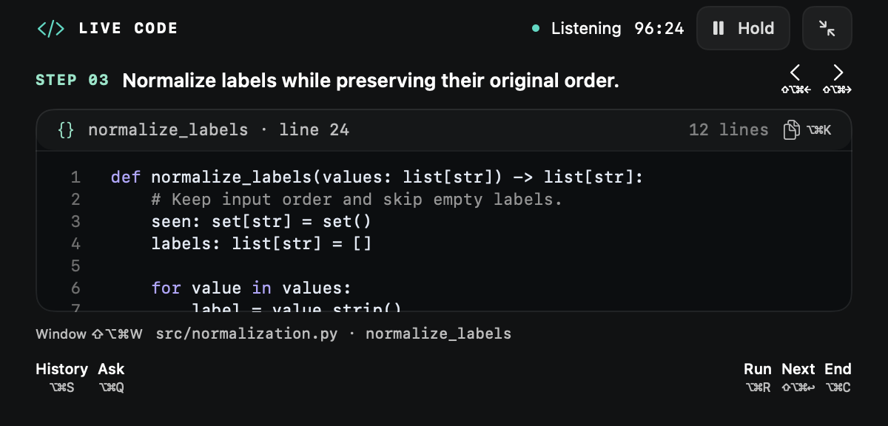
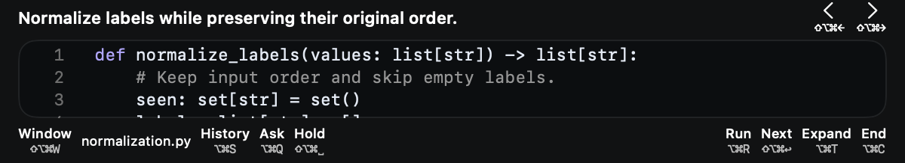
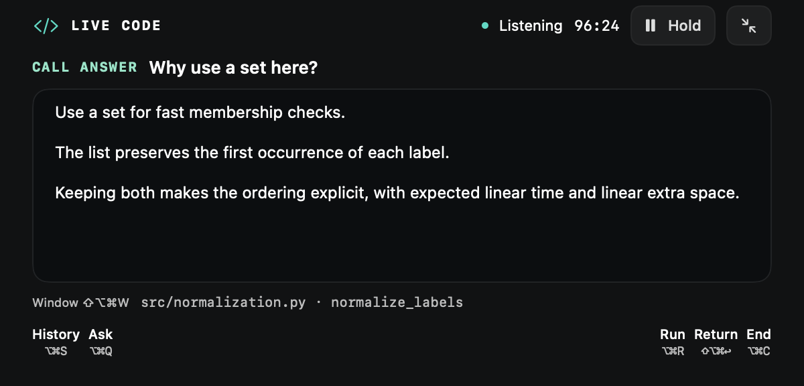

# Live Coding: shared Call size and keyboard controls — 5 September 2026

The user's latest sizing decision supersedes the earlier independent 740×420
Wave viewport. Code, Wave and ordinary Call now use the same saved expanded and
compact sizes. Standard defaults are 600×340 and 600×200; the current saved
compact height is about 161 points. Resizing either interview mode updates the
shared profile. Obsolete Code/Wave profile names resolve to Call for compatibility
and no longer appear as separate Settings choices. Wave glass remains independent.

## Reading and navigation

- Compact displays the complete scrollable code with a short explanation. No
  Open code gate. Code is 11-point monospaced, prose 12-point, compact explanation
  11-point. Syntax colours, line numbers and exact character preservation remain.
- Left/right controls and their shortcuts browse existing steps, including steps
  without code. Browsing earlier steps is stable when a new move arrives. Next
  is a separate request/advancement control.
- Buttons display the currently configured shortcut, including customized keys.
  Compact controls prioritize code space and use small shortcut captions.
- Keyboard scrolling moves by at most the viewport height minus one line. It
  cannot skip unread lines simply because the compact panel is short.
- Code, answers and history retain independent native scroll positions. Hold
  preserves the current document while pending material gets an unread count.

Default keyboard controls (all configurable in Settings → Shortcuts):

| Action | Shortcut |
|---|---|
| Previous / next saved step | ⇧⌥⌘← / ⇧⌥⌘→ |
| Scroll up / down | ⇧⌥⌘↑ / ⇧⌥⌘↓ |
| Next step / return | ⇧⌥⌘Return |
| Expand / compact | ⌥⌘T |
| Hold / resume | ⇧⌥⌘Space |
| Copy code or answer | ⌥⌘K |
| Run / stop check | ⌥⌘R |
| Ask / explain more | ⌥⌘Q / ⇧⌥⌘Q |
| History / return | ⌥⌘S |
| Previous / next answer | ⌥⌘[ / ⌥⌘] |
| Transcript / check evidence | ⇧⌥⌘T / ⇧⌥⌘E |
| Shortcut reference | ⇧⌥⌘/ |
| Select working window | ⇧⌥⌘W |
| End interview | ⌥⌘C |

## Window selection

The installed old window catalog returned nine on-screen windows and omitted
VS Code although CUA could inspect its existing spreadsheet window. Listing all
Spaces resolved the omission. The installed updated catalog returns 52 windows,
including `Preview wave_live_coding_engineering_guide.md — spreadsheet` (window
1592) and another VS Code window (1593). Enumeration reads metadata only.

Code preflight now has a direct Window control with a keyboard-accessible chooser.
The live view exposes the same control and shortcut. A live selection updates the
controller configuration and retained ledger, cancels the previous observation
loop, removes its private observation context, and starts exact PID/window/bundle
observation for the selected target. It does not restart the call. VS Code and
VS Code Insiders are supported. Saved files continue to come from the selected
project folder. Window capture itself is never redirected to an arbitrary window.

## Evidence and limits

- Eight shared-profile sizing tests passed: `/tmp/shared-call-sizing-tests.log`.
- Contracts suite passed 67 tests before the added wire-format regression; the
  targeted final contract tests also passed: `/tmp/coding-window-wire-tests.log`.
- Real controller fixture passed live window select/detach without changing call
  lifecycle, stale selection rejection, lifecycle recovery and source isolation:
  `/tmp/coding-window-live-probe.log`. Its host resolver is nil; this probe does
  not capture a window or microphone.
- Native reader fixtures pass exact code/answer offset restoration, preservation
  of tabs/Unicode/final newline, and overlapping keyboard scrolling at compact
  height: `/tmp/coding-keyboard-render.log`.
- `python3 scripts/verification/render_coding_viewport.py` renders the production
  reader at shared default, actual compact, min/max, long-code and answer sizes.
  The surrounding controls in these artifacts are synthetic; they are not
  installed interaction screenshots.
- Release builds passed and signed installation succeeded; the installed catalog
  was queried to confirm the VS Code window discovery fix. Final deployment log:
  `/tmp/coding-shared-size-keyboard-final-deploy.log`.

Full installed keyboard event delivery, chooser focus, live speech/capture and
end-to-end Hold/answer/return still require live acceptance. These checks do not
replace the original two-hour Wave rehearsal or its concurrency/latency targets.
